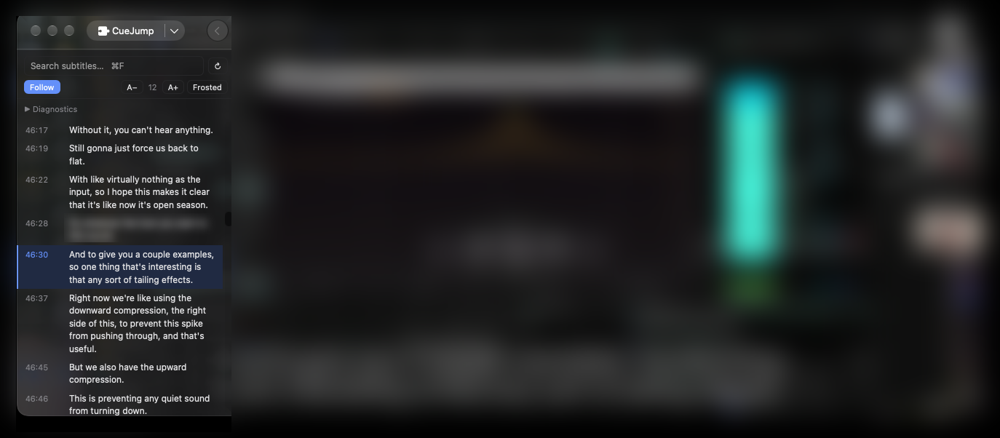

**English** · [简体中文](README.zh-CN.md) · [日本語](README.ja.md)

# CueJump

A subtitle sidebar for IINA. During playback it lists every subtitle cue of the current file; clicking any entry seeks the player to that cue's start time.

## What it is for

IINA shows only the subtitle line currently being played. There is no view of the surrounding text, and no way to locate something that has already been said. CueJump lists every cue in a sidebar and adds search and seeking on top of it. Typical uses:

- Returning to a passage you remember but cannot place in time
- Jumping to a specific section instead of playing the file in order
- Reviewing recorded lectures, interviews and meetings
- Language study, together with IINA's native previous/next subtitle seeking

## Features

| Feature | Description |
|---|---|
| Cue list | Every subtitle cue of the file, with timecode |
| Click to seek | Playback jumps to the start of the clicked cue |
| Search | Live filtering with highlighted matches; `Enter` seeks to the first hit |
| Follow playback | The current cue is highlighted and kept in the middle of the list; following pauses for 1.5 s after a manual scroll and can be switched off |
| Text size | 11–16 px, applied to both the list and the subtitle text |
| Background | Glass (fully transparent), frosted (semi-transparent) or solid |
| Interface language | Follows the system language, or English / 中文 / 日本語 |

## Installation

1. Download the latest `iina-cuejump-x.y.z.iinaplgz`
2. Double-click it and confirm in the dialog IINA shows
3. Quit IINA completely and start it again (plugins are loaded at launch)

Alternatively use `IINA → Settings → Plugins → Install from GitHub` and enter the repository URL.

## Usage

Open a video with subtitles and select the **CueJump** tab in the sidebar.

| Action | Result |
|---|---|
| Click an entry in the list | Playback seeks to the start of that cue |
| `⌘F` | Move focus to the search field |
| Type a query | Filter the list and highlight matches as you type |
| `Enter` | Seek to the first match |
| `Esc` | Clear the query |
| `Shift + ←` / `Shift + →` | IINA's native previous / next subtitle seeking |
| `↻` | Re-read the subtitle file (after editing an external subtitle) |

## How subtitles are located

Sources are tried in this order:

1. The external subtitle track currently loaded in IINA
2. A subtitle file in the same folder with the same base name, using the extension `.srt`, `.vtt`, `.ass` or `.ssa`

Supported formats are SRT, WebVTT and ASS / SSA. Override codes in ASS and SSA files (such as `{\b1}`) are stripped during parsing.

## Settings

`IINA → Settings → Plugins → CueJump` provides:

- **Sidebar background**: glass / frosted / solid
- **Text size**: 11–16 px
- **Diagnostics**: show the plugin's internal log in the sidebar
- **Language**: follow system / English / 中文 / 日本語

The `A−`, `A+` and background buttons in the sidebar change the same settings and take effect immediately.

## FAQ

**The sidebar is empty**
No subtitle file was found. Check that a file with the same base name as the video and the extension `.srt` (or `.vtt` / `.ass`) exists next to it, or load a subtitle track manually in IINA, then press `↻`.

**How is this different from IINA's built-in subtitles?**
IINA displays one line at a time. CueJump lists all of them and supports search and seeking. Both can be used at the same time.

**Does it modify my subtitle files?**
No. The plugin only reads them.

**Does it work with network streams?**
The list is built from a local subtitle file or an already-loaded subtitle track. For a network video without a matching local file, load the subtitle track in IINA first.

**How does it perform on long videos?**
Tested on a 2 h 45 min recording with 2117 cues; scrolling and searching showed no noticeable delay.

**Is it available on other platforms?**
No. IINA is macOS only, and so is this plugin.

**How are word-level timestamps displayed?**
Cues are aggregated into lines. An SRT with word-level timestamps parses normally, and seeking targets the start of the line.

## Compatibility

- IINA 1.5 or later; tested on 1.5.1
- macOS, Apple Silicon and Intel

## Privacy and permissions

The plugin only reads subtitle files. It does not write any file and makes no network requests. The declared permissions are `file-system` (to read the subtitle file) and `show-osd` (to display notices inside the player).

## Feedback

When opening an issue, please include the IINA version, the macOS version, the subtitle format, and the lines containing `cuejump` from `Window → Log Viewer`.

## License

MIT
